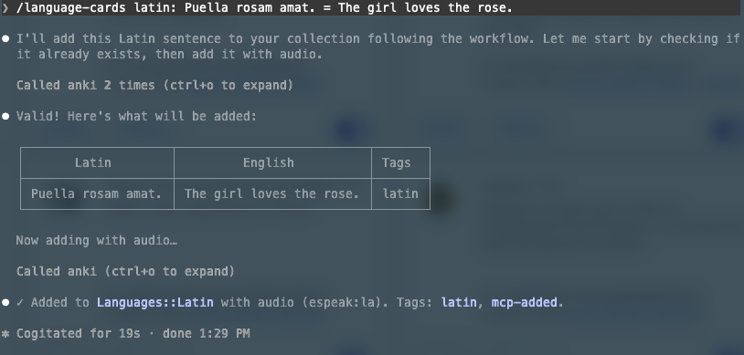
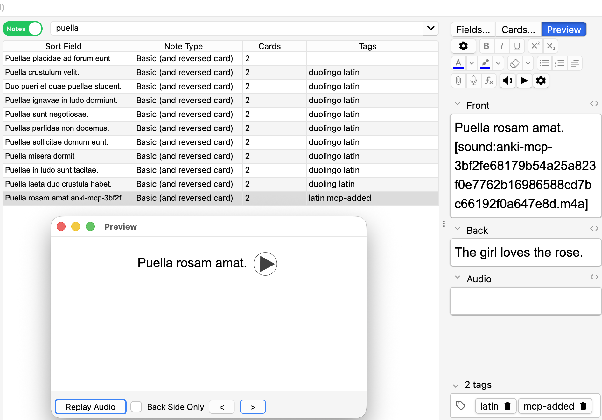

# anki-mcp

[](https://github.com/ikristina/anki-mcp/actions/workflows/ci.yml)

An MCP server that gives agents (Claude Code, Claude Desktop, …) access to your local Anki collection via [AnkiConnect](https://ankiweb.net/shared/info/2055492159).

Blog post about building it: [ikristina.github.io/blog/anki-mcp-server](https://ikristina.github.io/blog/anki-mcp-server/).

My other Anki project: [anki-new-tab](https://github.com/ikristina/anki-new-tab), a Chrome extension that turns every new tab into a quick review of due cards, with a Pomodoro timer. It also talks to Anki through AnkiConnect.

| Tool | What it does |
|---|---|
| `list_decks` | Decks with counts and `source` (`anki` / `yanki` = synced from Obsidian / `mixed`) |
| `describe_deck` | Works out a deck's format: note types, fields, audio field and its source, code values (e.g. WordType), templates, tag patterns, samples |
| `list_note_types` | Note types with fields in order and note counts; filter by name to also see template front/back fields. For empty decks or newly imported types |
| `search_notes` | Anki search syntax, paginated compact previews |
| `find_similar_notes` | Finds notes by *meaning* ("cards about consensus", "cat" → *el gato*), from a text or an existing note id; catches near-duplicates exact search misses. Needs the optional [semantic index](#semantic-search-index-optional) |
| `get_notes` | Full content for specific note ids; `raw=True` returns stored HTML and `[sound:]` tags, for editing |
| `get_weak_cards` | Most-forgotten cards (lapses, then ease), optionally per deck |
| `get_deck_profile` / `set_deck_profile` | Your saved per-deck conventions (note type, audio field + voice, how to fill each field, tags, rules). Stored in a local JSON file, not in Anki |
| `add_audio` | Adds pronunciation audio to *existing* notes that lack it; dry run by default, batches of ≤50, skips notes that already have audio. `replace=True` re-voices them (e.g. after switching voice), and `texts` sets the spoken text per note (e.g. with macrons) |
| `update_notes` | Edits fields of existing notes, adds tags or appends a local `image`; dry run by default with an old → new diff, tags `mcp-edited`, refuses Yanki notes and edits that would drop audio |
| `delete_notes` | Permanently deletes notes by id (cards and history too); dry run by default, refuses Yanki notes. Only on the user's explicit request |
| `move_cards` | Moves the cards matching an Anki search into another deck (history kept, normal sync); dry run by default with a count, the decks they come from and a sample; ≤200 cards per call, skips Yanki cards, refuses a Yanki target, keeps the semantic index's deck filter right |
| `convert_notes` | Changes the note type of existing notes (cards and review history kept) with a field map. **High risk: Anki then requires a one-way full sync.** Dry run by default; the real run needs the user's confirmation that every device is synced, backs up the affected decks to `.apkg` first, refuses a first run over 20 notes (trial batch first), stops at the first error and logs to a history file. Refuses Yanki notes |
| `restyle_note_type` | Changes an existing note type's CSS and card template HTML by exact-match patch (`old` must occur once) or full replace; read the current text with `list_note_types(name, full=True)`. Checks placeholders, lists the decks it affects, saves the old look to a backup first. Normal sync, no full sync |
| `deck_options` | Reads or sets a deck's new cards/day and reviews/day. The limits live in a preset that decks share, so changing a shared one needs `change_shared_preset=True`. Per-deck "This deck" overrides are invisible to AnkiConnect |
| `create_note_type` | Creates a note type (fields, card templates, styling) from arguments or a JSON file, e.g. `examples/note_types/english-vocab.json`. Dry run by default; checks every `{{placeholder}}`; refuses an existing name. Adding a note type most likely forces a one-way full sync, so the real run needs the user's confirmation that every device is synced. Never edits existing types |
| `suspend_cards` | Suspends (or unsuspends) the cards matching a search, e.g. `\"deck:X\" is:new` to hide only never-studied cards; scheduling untouched, normal sync. Dry run by default, `limit` to wake cards gradually, tags what it suspends (`mcp-suspended`) so the undo restores only those |
| `create_deck` | Creates an empty deck (and missing parents) so `add_notes` can use it; reports similar existing names, leaves an existing deck alone, supports `dry_run` |
| `export_deck` | Writes a deck (with subdecks and media) to an `.apkg` file to share or back up; review history only if asked; never overwrites silently |
| `sync` | Syncs desktop Anki with AnkiWeb (normal syncs only; refuses a full sync and says why), so notes added on a phone can be tidied and voiced remotely. See [docs/remote-from-phone.md](docs/remote-from-phone.md) |
| `add_notes` | Batch add with validation, `dry_run`, duplicate check, auto-tag `mcp-added`, optional free TTS audio and a local `image`; refuses Yanki-owned decks. Warns (never blocks) about near-duplicates in any deck: the same word apart from article/case/accents (`cumbre` vs `la cumbre`), plus similar meaning when the [semantic index](#semantic-search-index-optional) is set up |

Not sure what to ask for? [docs/capabilities.md](docs/capabilities.md) lists what's possible, what isn't yet, and what card-design terms mean.

Skills in `.claude/skills/`:
- `flashcards` routes cards: technical topics become markdown in the Obsidian vault (synced by Yanki), and everything else goes straight to Anki.
- `language-cards` (`/language-cards <words>`) adds vocabulary with pronunciation audio to any language deck, following that deck's profile. If a deck has no profile yet, it works one out with `describe_deck` and asks you to confirm it. It also tidies cards you typed on your phone: fixes the text, adds audio and formats alternative answers.

## Installation

### Requirements

- macOS (the offline voices and audio conversion use the built-in `say` and `afconvert`)
- [uv](https://docs.astral.sh/uv/) (`brew install uv`); it installs Python 3.11+ for you if needed
- [Anki](https://apps.ankiweb.net/) desktop
- [Claude Code](https://claude.com/claude-code)

### 1. Anki + AnkiConnect

1. In Anki: **Tools → Add-ons → Get Add-ons…**, enter code `2055492159`, and restart Anki.
2. Keep Anki open whenever you use the server. AnkiConnect listens on `http://127.0.0.1:8765`.

### 2. A Latin voice (if you study Latin)

Google's voices have no real Latin. `eSpeak NG` has a Latin voice, and at first it seemed like a good option even though it is VERY robotic. In practice turned out that its pronunciation is often wrong, so I trained my own Classical Latin voice with Piper instead. It sounds far more natural. It's not shared (the base model's license forbids redistribution), but you can build the same one: [docs/building-a-tts-voice.md](docs/building-a-tts-voice.md). Install it as `piper:la_LA-vox-medium` (see [Audio voices](#audio-voices)).

`eSpeak NG` is still needed: Piper uses its Latin rules to turn text into phonemes.

```bash
brew install espeak-ng
```

Check it: `espeak-ng --voices=la` should list `Latin`.

### 3. The server

```bash
git clone <this repo> ~/Projects/anki-mcp   # or copy the folder
cd ~/Projects/anki-mcp
uv sync
uv run python scripts/smoke.py              # read-only check over stdio; Anki must be running
```

### 4. Register with Claude Code

```bash
claude mcp add anki --scope user -- uv --directory /absolute/path/to/anki-mcp run anki-mcp
```

Then start a new Claude Code session and run `/mcp`: `anki` should show as connected. `--scope user` makes the tools available in every project. The skills only load when Claude Code runs inside this folder, unless you copy `.claude/skills/*` to `~/.claude/skills/`.

### Other agents (Claude Desktop, Cursor, VS Code, Codex, Gemini CLI, …)

MCP is agent-agnostic, so any MCP client can run this server. No clone is needed: `uvx` builds it straight from GitHub. Steps 1–2 (Anki + AnkiConnect, Latin voice) still apply.

The command every client runs:

```bash
uvx --from git+https://github.com/ikristina/anki-mcp anki-mcp
```

GUI apps often don't inherit your shell's `PATH`. If the server fails to start, replace `uvx` with its absolute path (`which uvx`, e.g. `/Users/you/.local/bin/uvx`).

**Claude Desktop** (`~/Library/Application Support/Claude/claude_desktop_config.json`), **Cursor** (`~/.cursor/mcp.json`), **Windsurf**, **Gemini CLI** (`~/.gemini/settings.json`), and most other clients use the `mcpServers` format:

```json
{
  "mcpServers": {
    "anki": {
      "command": "uvx",
      "args": ["--from", "git+https://github.com/ikristina/anki-mcp", "anki-mcp"]
    }
  }
}
```

**VS Code / GitHub Copilot** (`.vscode/mcp.json`) uses `servers`:

```json
{
  "servers": {
    "anki": {
      "type": "stdio",
      "command": "uvx",
      "args": ["--from", "git+https://github.com/ikristina/anki-mcp", "anki-mcp"]
    }
  }
}
```

**OpenAI Codex CLI** (`~/.codex/config.toml`):

```toml
[mcp_servers.anki]
command = "uvx"
args = ["--from", "git+https://github.com/ikristina/anki-mcp", "anki-mcp"]
```

The tools work the same everywhere. The **skills** (`.claude/skills/`) are Claude Code's format; with other agents, copy the relevant `SKILL.md` body into that agent's rules/instructions file. Deck-specific conventions live in deck profiles (below), not in the skills, so the skills work with any collection.

### Optional

- `ANKI_CONNECT_URL`, if AnkiConnect isn't on `http://127.0.0.1:8765` (`claude mcp add anki -e ANKI_CONNECT_URL=http://... -- ...`).
- `ANKI_MCP_BACKUP_DIR` (default `~/.config/anki-mcp/backups`) and `ANKI_MCP_HISTORY` (default `~/.config/anki-mcp/convert_history.jsonl`): where `convert_notes` writes its pre-conversion backups and its log.
- `ANKI_MCP_EXPORT_DIR`: the folder `export_deck` uses when no path is given (default `~/Desktop`), e.g. a synced Google Drive or Dropbox folder.

### Semantic search index (optional)

An index of every note's meaning, which the `find_similar_notes` tool searches: "cards about consensus", or a near-duplicate that Anki's exact-match check misses. No other tool depends on it, and the server works the same without it (`find_similar_notes` then says how to set it up).

```bash
docker run -d --name anki-redis --restart unless-stopped -p 127.0.0.1:6379:6379 \
  -v anki-redis-data:/data redis:8 redis-server --appendonly yes --save "60 1" --save "300 100"
uv sync --extra rag                    # fastembed (ONNX, no torch) + the Redis client
uv run --extra rag anki-mcp-index      # Anki must be running; first run embeds everything (a few minutes)
```

- Embeddings come from a free local model (`paraphrase-multilingual-MiniLM-L12-v2`, 384 dimensions, handles Spanish, French, Norwegian, Latin and English) and are stored in **Redis 8** (vector search built in). The volume and AOF/RDB settings above keep them across restarts; the index is derived data, so it can always be rebuilt.
- Later runs re-embed only notes that changed since the last run and drop deleted ones. `--full` rebuilds from scratch, `--limit N` caps one run. Changing the model rebuilds automatically.
- A card moved to another deck keeps its old deck in the index until the next `--full` run (Anki doesn't bump a note's modified time on a move).
- `add_notes` also uses it: each valid note gets a `similar` list when an existing note has the same word (checked with Anki's own search, no index needed) or a similar meaning (similarity ≥ 0.8, from the index). Without the index, `add_notes` still does the same-word check and says `similar_check: semantic check skipped`.
- To use the tools from an agent, register the server with the extra: `claude mcp add anki --scope user -- uv --directory /absolute/path/to/anki-mcp run --extra rag anki-mcp`. Re-run `anki-mcp-index` now and then (it takes seconds when little changed): notes added since the last run aren't found yet, and `find_similar_notes` reports `indexed_at`.
- `ANKI_MCP_REDIS_URL` points at a different Redis. If Redis is down, only these commands fail, with a message saying how to start it.
- How the model was chosen: `uv run --extra rag python scripts/rag_eval.py build` then `score` (recall@5 and MRR on query sets derived from your own collection; results stay in the gitignored `evals/retrieval/`). Plan: [ROADMAP.md](ROADMAP.md), Phase 8.

### Observability (optional): OpenTelemetry traces, metrics and logs

The server always logs to stderr (Claude Code keeps it in its MCP logs; `ANKI_MCP_LOG_LEVEL=DEBUG` for more). To export traces, metrics and logs over OTLP/HTTP, install the `otel` extra and point it at a collector. The quickest local backend is Grafana's all-in-one image, which stores all three signals and has a UI at http://localhost:3000:

```bash
docker run -d --name otel-lgtm -p 3000:3000 -p 4318:4318 grafana/otel-lgtm
claude mcp add anki --scope user -e OTEL_EXPORTER_OTLP_ENDPOINT=http://localhost:4318 \
  -- uv --directory /absolute/path/to/anki-mcp run --extra otel anki-mcp
```

To fill Grafana with data without using an agent, generate traffic. The script starts its own server with exporting on and makes random read-only calls, dry-run writes and a few deliberate mistakes. It never writes to the collection:

```bash
uv run --extra otel python scripts/otel_traffic.py              # 60 scenarios, about 2 minutes
uv run --extra otel python scripts/otel_traffic.py --calls 300  # more data, for rate() and latency graphs
```

Any OTLP backend works (Jaeger, Honeycomb, Grafana Cloud…); the standard `OTEL_*` variables apply (`OTEL_EXPORTER_OTLP_HEADERS` for API keys, `OTEL_SERVICE_NAME`, `OTEL_SDK_DISABLED=true`). Without an endpoint, nothing is exported.

- **Traces**: one span per tool call (`tools/call add_notes`, from the MCP SDK), with child spans per AnkiConnect request (`ankiconnect findNotes`) and per audio clip (`tts google`). Failed calls carry the error message the model saw.
- **Metrics**: `anki_mcp.tool.calls` / `anki_mcp.tool.duration` (by tool and outcome), `anki_mcp.ankiconnect.duration` (by action), `anki_mcp.tts.duration` (by engine and voice; Google 429s show up here), `anki_mcp.notes.written` (by operation and deck). Exported every 10s (`OTEL_METRIC_EXPORT_INTERVAL`).
- **Logs**: writes (notes added, voiced, updated, synced) and tool errors.

Note contents are never recorded, but error messages can quote the word being voiced. Queries, troubleshooting, and how to add the same to your own MCP server: [docs/observability.md](docs/observability.md).

### Obsidian (optional, for Yanki decks)

This server never reads or writes Obsidian. It only spots Yanki decks (`source: yanki`) and refuses to add cards to them. To put new cards there, the agent has to write markdown into your vault by some other route: a separate Obsidian MCP server, or plain file access to the vault folder. Either works. A filesystem-based server such as [`obsidian-mcp`](https://www.npmjs.com/package/obsidian-mcp) (`claude mcp add obsidian -- npx -y obsidian-mcp /path/to/vault`) edits the files directly, so Obsidian doesn't need to be running. A server built on the Local REST API plugin needs Obsidian open but can also run commands. Either way, you still run **Yanki: Sync** in Obsidian to get the cards into Anki. Without either kind of access, the `flashcards` skill can still write cards for Anki-owned decks, but for Yanki decks it can only show you the markdown to paste in yourself.

## Deck profiles

Some things `describe_deck` can't infer: which voice a deck uses, which field is spoken, "nouns include the article". Save them once as a deck profile, and every session and agent follows them:

- File: `~/.config/anki-mcp/profiles.json` (override with `ANKI_MCP_PROFILES=/path/to/file.json`). It's plain JSON, so edit it by hand if you like. Nothing is written to your Anki collection.
- `set_deck_profile` checks each profile against Anki before saving: the deck and note type must exist, the field names must belong to that note type, and the voice must work.
- Agents are told to save a profile only after you confirm it. The `language-cards` skill proposes one the first time you add to a deck that has none.
- [`examples/profiles.json`](examples/profiles.json) holds my Spanish, French and Latin profiles. To start from them, copy the file to `~/.config/anki-mcp/profiles.json` and rename the decks to match yours.

## Audio voices

`add_notes` takes `audio: {"field": ..., "voice": ...}`. All engines are free:

| Voice string | Engine | Needs | Used for |
|---|---|---|---|
| `es-MX`, `fr`, `de`, `pt-BR`, … | Google Translate (gTTS) | internet | Spanish, French (the same voices HyperTTS's GoogleTranslate service uses) |
| `espeak:la` | eSpeak NG | `brew install espeak-ng` | Latin, but robotic and often mispronounced; I replaced it with the Piper voice below |
| `macos:Alice` (any `say -v '?'` voice) | macOS `say` | macOS | natural offline voices |
| `edge:es-MX-JorgeNeural` (male: also `es-ES-AlvaroNeural`, `es-AR-TomasNeural`) | Microsoft Edge neural, via unofficial `edge-tts` | internet; no key | natural online voices incl. male Spanish; unofficial endpoint, may break |
| `random:es-MX,edge:es-MX-JorgeNeural` | any listed voices | as the voices | one voice per note, picked by a hash of the text (stable across re-runs) |
| `piper:la_LA-vox-medium` (any `<name>.onnx` + `.onnx.json` in `~/.local/share/piper-voices/`) | Piper (neural) | `uv tool install piper-tts` + the voice files | natural offline voices, incl. a self-trained Latin one ([how](docs/building-a-tts-voice.md)) |

Google files are MP3; the offline engines produce M4A (AAC). Anki plays both.

Listen before trusting a voice. Even a good one mispronounces rare words: Google `en-US` gets *chimerical* wrong where `en-GB` is right, and only `macos:Samantha` says *kvetch* correctly. To fix one card, clear its audio field in Anki and run `add_audio` on just that note with a different voice (or use `replace=True`).

## Development

```bash
uv run pytest -q                # unit tests: fake in-memory AnkiConnect, no Anki/network needed (runs in CI)
uv run python scripts/smoke.py  # end-to-end over stdio against your real collection (read-only; Anki must be running)
uv run --extra rag python scripts/rag_eval.py build && uv run --extra rag python scripts/rag_eval.py score  # embedding-model comparison on your collection (read-only, free)
uv run python evals/run.py --models haiku sonnet --repeats 5  # agent evals via `claude -p` against fakes (uses plan usage)
```

Eval results and method: [docs/evals.md](docs/evals.md). See [LEARNINGS.md](LEARNINGS.md) for design notes.


## Example use



